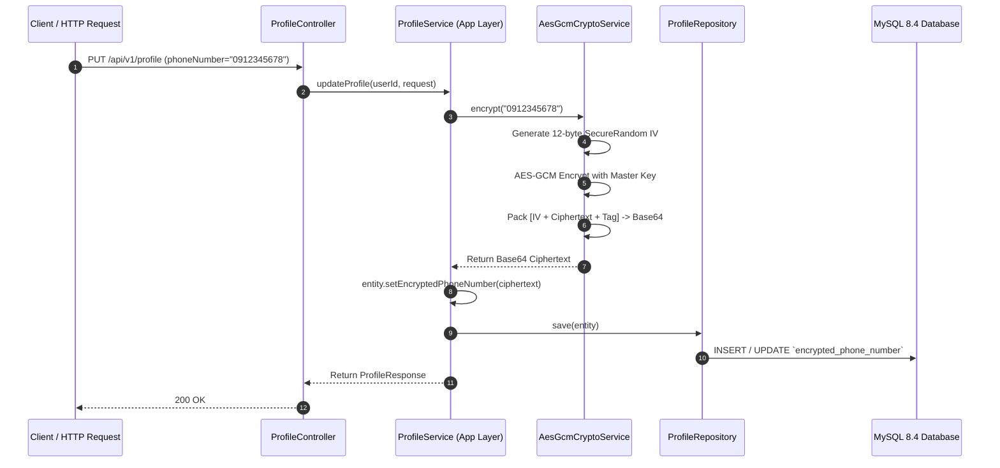
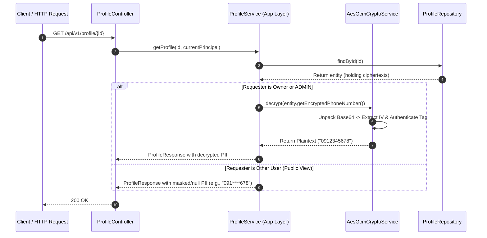

# [SPEC-001]: Service-Layer Symmetric Encryption (AES-256-GCM) for User Profile PII

> **Status:** `Completed`  
> **Version:** `1.2.0`  
> **Author:** AI Agent & Engineering Team  
> **Date:** 2026-11-13  
> **Approved-By:** `User`  
> **Approved-At:** `2026-11-12`  
> **Approved-Hash:** `Approved-Direct`  
> **Upstream Spec Kit:** Compatible with Spec Kit v1.0+  
> **Target Path:** `backend/src/main/java/com/campushub/`  

---

## 1. Overview & Objective

### 1.1 Problem Statement
In accordance with the [CampusHub Code of Conduct](file:///home/tranquan/Project/CampusHub/CODE_OF_CONDUCT.md#L22) (*"Sharing another person's private information without consent"*), students store private contact and identity verification details (`phoneNumber`, `studentCardId`). 

To maximize security and enforce strict least-privilege access, encryption must execute explicitly in the **Application Service Layer**. This guarantees that:
1. JPA entities and Level-1/Level-2 persistence caches hold only encrypted ciphertexts in Java memory.
2. Decryption is an intentional, authorized business operation executed only when an authorized caller requests the profile.
3. Database storage (MySQL 8.4) receives and stores only Base64-encoded AES-256-GCM ciphertexts.

### 1.2 User Stories
- **As a** student user, **I want** my phone number and student card ID encrypted at the service layer **so that** my plaintext data is never exposed in memory caches or database dumps.
- **As an** application developer, **I want** explicit encryption and decryption methods in the service layer **so that** access controls and data masking (e.g. `091****678`) can be enforced before decryption occurs.

### 1.3 Scope Boundaries
- **In-Scope (Mandatory):**
  - Implement an authenticated symmetric cryptographic service (`AesGcmCryptoService`) using `AES/GCM/NoPadding` (256-bit key, 12-byte random IV, 128-bit authentication tag).
  - Explicit Service-Layer orchestration: `ProfileService` explicitly calls `cryptoService.encrypt(...)` on profile create/update and `cryptoService.decrypt(...)` on profile retrieval for authorized users.
  - Entity schema: `encrypted_phone_number` and `encrypted_student_card_id` stored as `VARCHAR(512)` in MySQL.
  - Externalized master encryption key (`app.security.encryption-key` / `${APP_ENCRYPTION_KEY}`) in `application.properties`.
  - Comprehensive unit and service slice tests covering encryption roundtrips, random IV uniqueness, authorization enforcement, tampering detection, and null safety.
- **Out-of-Scope (Strictly Forbidden in this task):**
  - **Passwords:** Passwords must strictly remain on one-way salted **BCrypt** hashing.
  - **Email:** The `email` field must remain unencrypted to support standard B-Tree indexing and `findByEmail` lookups.
  - **No JPA AttributeConverter Magic:** Encryption is controlled explicitly in the Service Layer, not implicitly via JPA entity converters.
  - **Public Feed:** Community posts, comments, marketplace item titles, and categories remain unencrypted.
  - **No modifications to `src/` during this planning phase.**

---

## 2. Data Models & Interface Contracts

### 2.1 Cryptographic Specification
* **Algorithm:** `AES/GCM/NoPadding` (Advanced Encryption Standard in Galois/Counter Mode).
* **Key Length:** 256 bits (32 bytes), Base64-encoded via environment configuration `${APP_ENCRYPTION_KEY}`.
* **Nonce / IV:** 12 bytes generated per encryption invocation using `java.security.SecureRandom`.
* **Authentication Tag:** 128 bits (16 bytes) automatically appended by GCM.
* **Storage Payload Format:** Base64-encoded string: `Base64([12-byte IV] + [Ciphertext + 16-byte Tag])`.
* **Database Column Size:** `VARCHAR(512)` to safely accommodate Base64 payload expansion.

### 2.2 Component & Service Contracts

#### `AesGcmCryptoService` (Cryptographic Engine)
```java
package com.campushub.common.security.crypto;

public interface AesGcmCryptoService {
    /**
     * Encrypts plaintext using AES-256-GCM with a dynamic 12-byte random IV.
     * @param plainText raw sensitive string (null/blank safe)
     * @return Base64-encoded string containing [IV + Ciphertext + Tag], or null if plainText is null
     */
    String encrypt(String plainText);

    /**
     * Decrypts Base64-encoded AES-256-GCM payload.
     * @param cipherText Base64 string containing [IV + Ciphertext + Tag]
     * @return decrypted plaintext string, or null if cipherText is null
     * @throws CryptoException if decryption fails, data is corrupted, or authentication tag verification fails
     */
    String decrypt(String cipherText);
}
```

#### Entity Contract (Target: User / Profile Entity)
```java
// Entity strictly stores ciphertext; Java entity in memory never holds raw PII
@Column(name = "encrypted_phone_number", length = 512)
private String encryptedPhoneNumber;

@Column(name = "encrypted_student_card_id", length = 512)
private String encryptedStudentCardId;
```

#### Service Layer Contract (`ProfileService`)
```java
public interface ProfileService {
    /**
     * Updates profile PII by explicitly encrypting sensitive fields before persisting.
     */
    ProfileResponse updateProfile(UUID userId, UpdateProfileRequest request);

    /**
     * Retrieves profile. Decrypts PII only if requester is resource owner or ADMIN;
     * otherwise returns masked PII (e.g. 091****789) or null.
     */
    ProfileResponse getProfile(UUID targetUserId, UserPrincipal requester);
}
```

---

## 3. Logic Flow & State Transitions

### 3.1 Save Flow (Service-Layer Explicit Encryption)


### 3.2 Read Flow (Authorized Service-Layer Decryption)


---

## 4. Edge Cases & Error Handling

- [x] **Null or Empty Input:**
  - If plaintext is `null` or empty `""`, `encrypt()` returns `null`. The database stores `null`.
- [x] **Data Tampering & Tag Authentication Failure:**
  - If ciphertext is altered in MySQL, `javax.crypto.AEADBadTagException` is thrown.
  - Caught and wrapped into a safe `CryptoException("Decryption integrity verification failed")`.
  - Secret keys, IVs, or stack details must never leak to API responses or logs.
- [x] **Missing or Invalid Master Key:**
  - If `APP_ENCRYPTION_KEY` is not present or not 256 bits (32 bytes), the application must fail-fast during startup with `IllegalStateException`.
- [x] **Uniqueness across Invocations (Non-Deterministic):**
  - Encrypting the exact same phone number twice produces completely different Base64 ciphertexts due to dynamic 12-byte random IVs.

---

## 5. Acceptance Criteria (Verification Matrix)

- [x] **AC-1:** `AesGcmCryptoService` successfully encrypts and decrypts UTF-8 plain text using AES-256-GCM.
- [x] **AC-2:** Two encryptions of the identical plaintext yield distinct ciphertexts (verifying unique 12-byte IV per encryption).
- [x] **AC-3:** Modifying any bit of the Base64 ciphertext triggers `AEADBadTagException` and throws a controlled `CryptoException`.
- [x] **AC-4:** Service-layer orchestration explicitly encrypts `phoneNumber` and `studentCardId` prior to invoking repository save.
- [x] **AC-5:** Service-layer read operations decrypt PII only for authorized requesters (owner / ADMIN) and mask or omit PII for public access.
- [x] **AC-6:** Automated unit tests cover the cryptographic engine, tamper detection, and service-layer authorized decryption with 100% test pass rate.

---

## 6. Change Log

| Version | Date | Author | Summary |
| :--- | :--- | :--- | :--- |
| `1.0.0` | 2026-11-12 | AI Agent & Team | Initial draft specification using JPA AttributeConverter. |
| `1.1.0` | 2026-11-12 | AI Agent & Team | **Changed to Option 1 (Service-Layer Explicit Encryption)**. Removed implicit JPA converter in favor of explicit service orchestration, entity-level ciphertext storage, and authorized decryption flow. Status set to `In Review`. |
| `1.2.0` | 2026-11-13 | SDD Verifier | Verified all Acceptance Criteria (AC-1..AC-6), Zero-Trust audit passed, 41/41 automated tests passed. Status updated to `Completed`. |
