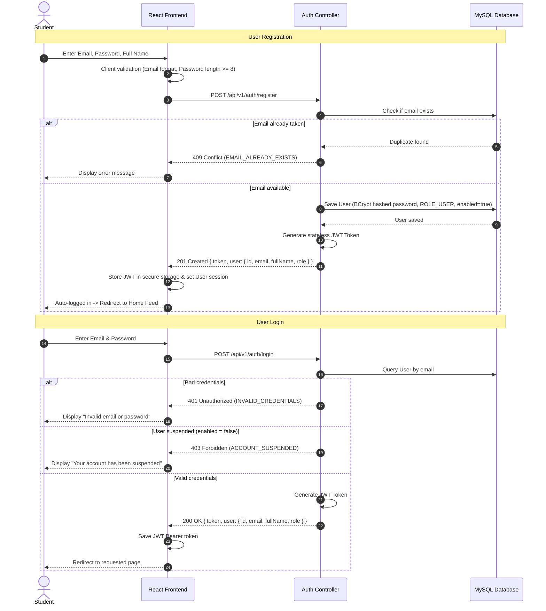
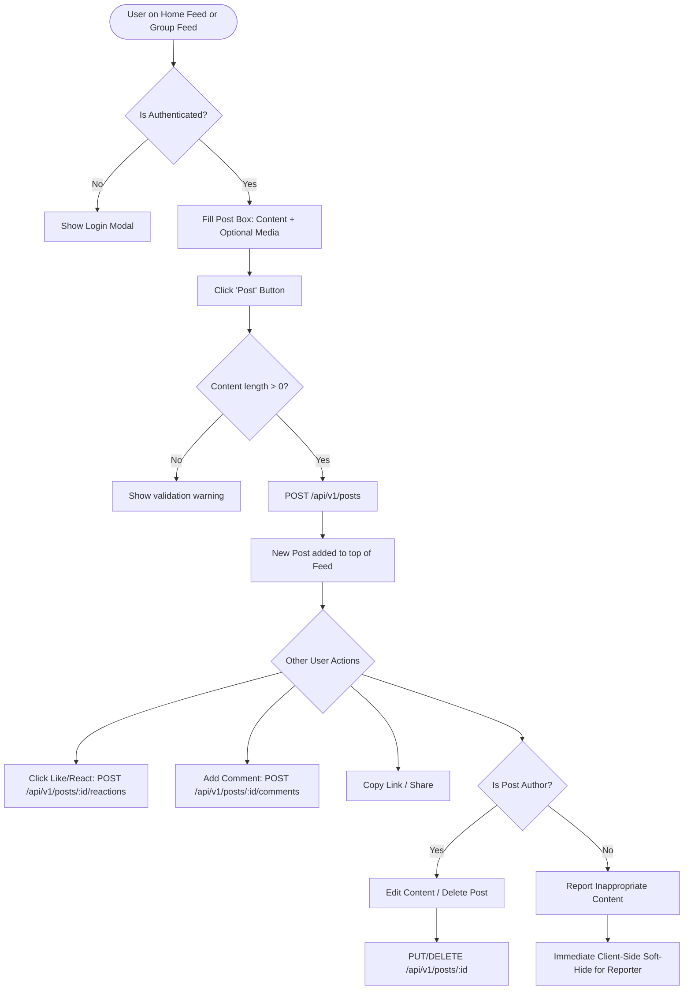
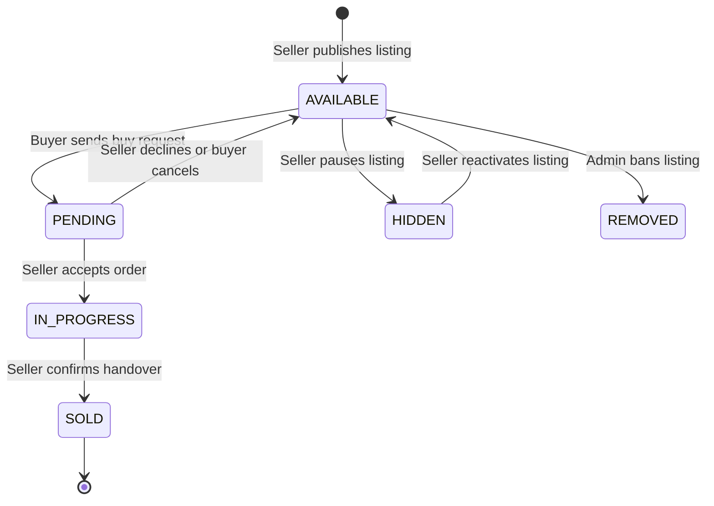
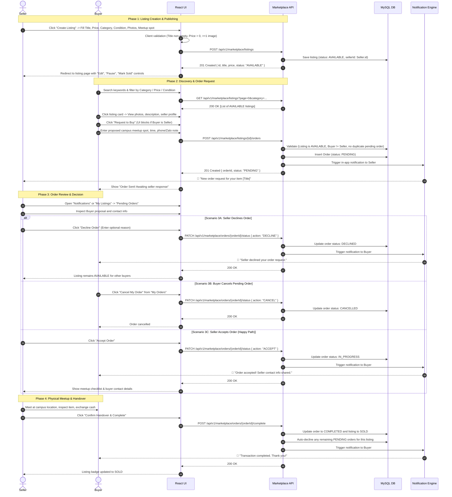
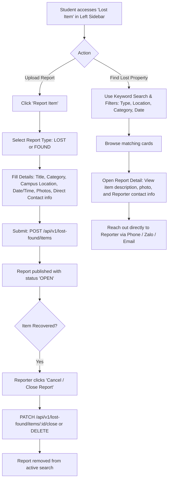
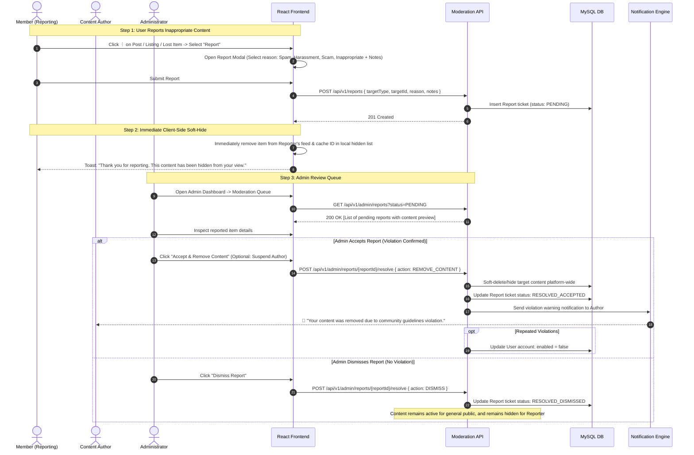
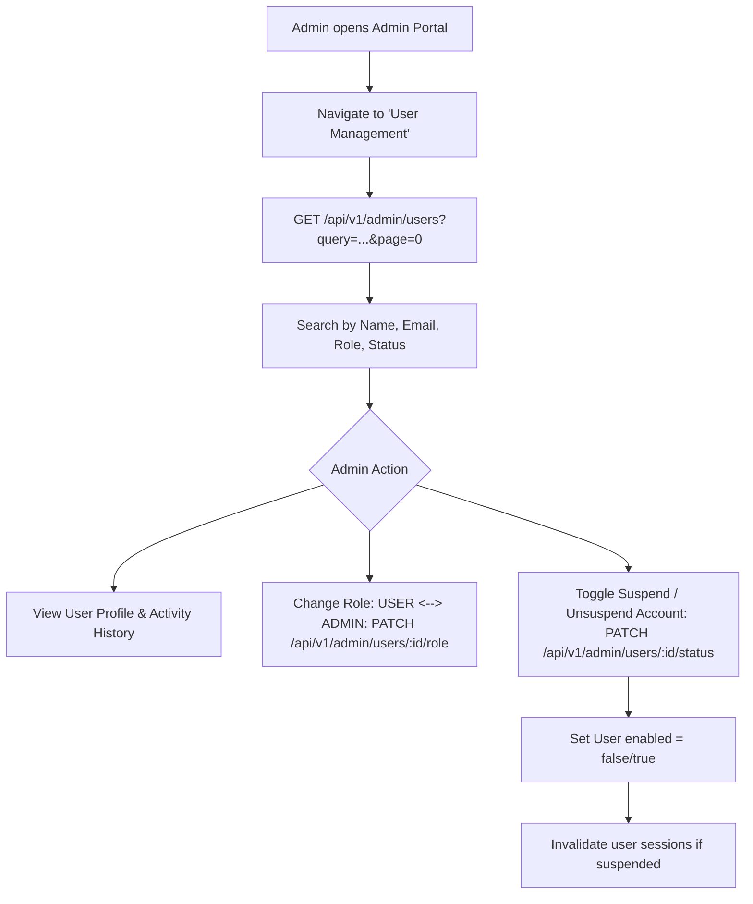

# CampusHub — Comprehensive User Flows Specification

> **Status:** Approved Baseline  
> **Target Audience:** Frontend Developers, Backend Engineers, QA / Testers, UI/UX Designers  
> **Source Documents:** [`PROJECT_OVERVIEW.md`](../README.md), [`UC_campusHub_v2.drawio.pdf`](../my_document/UC_campusHub_v2.drawio.pdf), [`docs/backend-conventions.md`](backend-conventions.md)

---

## Table of Contents
1. [Information Architecture & Navigation Layout](#1-information-architecture--navigation-layout)
2. [User Roles & Access Control Matrix](#2-user-roles--access-control-matrix)
3. [Module 1: Authentication & Profile Flows](#3-module-1-authentication--profile-flows)
4. [Module 2: Community & Groups Flows](#4-module-2-community--groups-flows)
5. [Module 3: Marketplace & Order Flows](#5-module-3-marketplace--order-flows)
6. [Module 4: Lost Item (Lost & Found) Flows](#6-module-4-lost-item-lost--found-flows)
7. [Module 5: Content Reporting & Moderation Flows](#7-module-5-content-reporting--moderation-flows)
8. [Module 6: Notifications Flows](#8-module-6-notifications-flows)
9. [Module 7: Admin Operations & User Management](#9-module-7-admin-operations--user-management)
10. [End-to-End API Mapping & Error Handling](#10-end-to-end-api-mapping--error-handling)

---

## 1. Information Architecture & Navigation Layout

CampusHub adopts a **Feed-First Hub** structure with persistent left-sidebar navigation:

```
┌─────────────────────────────────────────────────────────────────────────────┐
│ CampusHub Top Navbar: [Logo] [Global Search Bar]  [🔔 Notifications] [User Avatar] │
├───────────────────┬─────────────────────────────────────────────────────────┤
│ Left Sidebar      │ Main Content Viewport                                   │
│                   │                                                         │
│ 🏠 Home Feed      │ [Community Feed: Create Post + Posts / Comments]        │
│                   │                                                         │
│ GROUPS (Admin)    │ (Or if item selected from sidebar):                     │
│  ├ 📚 Study space │  - Specific Group Feed                                  │
│  └ 💼 Project     │  - Marketplace Listing Grid & Order Management          │
│                   │  - Lost & Found Bulletin & Filter Board                 │
│ MODULES           │  - Admin Moderation & User Management Panel             │
│  ├ 🛒 Marketplace │                                                         │
│  └ 🔍 Lost Item   │                                                         │
│                   │                                                         │
│ ⚙️ Admin Panel    │                                                         │
└───────────────────┴─────────────────────────────────────────────────────────┘
```

- **Home Page (`/`)**: Central Community discussion feed where authenticated Members view posts, create posts, write comments, and react.
- **Left Sidebar**:
  - **Admin-Created Groups**: e.g., `"Study space"`, `"Project"` (focused discussion channels).
  - **Specialized Modules**: Dedicated links to `"Marketplace"` and `"Lost Item"`.
  - **Admin Portal**: Visible only to users with `ROLE_ADMIN`.

---

## 2. User Roles & Access Control Matrix

| Capability | Guest (Unauthenticated) | Member (`ROLE_USER`) | Admin (`ROLE_ADMIN`) |
|---|:---:|:---:|:---:|
| Browse Public Home Feed & Groups | ✅ Read-only | ✅ Read & Interact | ✅ Full Access |
| Search Marketplace & Lost Items | ✅ Read-only | ✅ Read & Interact | ✅ Full Access |
| Create Post / Comment / React | ❌ Redirect to Login | ✅ Own content | ✅ Moderate all |
| Join Community Groups | ❌ Redirect to Login | ✅ Instant Join | ✅ Auto-Joined / Manage |
| Create Marketplace Listing | ❌ Redirect to Login | ✅ Full | ✅ Manage |
| Place Buy Order / Request | ❌ Redirect to Login | ✅ (Buyer $\ne$ Seller) | ❌ Restricted |
| Upload Lost/Found Report | ❌ Redirect to Login | ✅ Full | ✅ Manage |
| Cancel / Delete Lost Report | ❌ Redirect to Login | ✅ Own report | ✅ Moderate all |
| Report Inappropriate Content | ❌ Redirect to Login | ✅ Immediate soft-hide | ✅ Direct action |
| Review Moderation Queue | ❌ 403 Forbidden | ❌ 403 Forbidden | ✅ Full |
| Manage Users & Roles | ❌ 403 Forbidden | ❌ 403 Forbidden | ✅ Full |
| Create / Archive Community Groups | ❌ 403 Forbidden | ❌ 403 Forbidden | ✅ Full |

---

## 3. Module 1: Authentication & Profile Flows

### 3.1 Registration & Login Flow



### 3.2 User Profile Flow (View & Edit)
1. **View Profile:**
   - User clicks their avatar in the top navbar $\rightarrow$ navigates to `/profile/{id}`.
   - Frontend calls `GET /api/v1/users/{id}` (or `GET /api/v1/users/me` for own profile).
   - Shows: Full Name, Email, University / Major, Bio, Avatar, Join Date, user's active Marketplace listings, and user's Lost & Found reports.
2. **Edit Profile:**
   - User clicks **"Edit Profile"** (available only if viewing own profile).
   - Form allows updating: Bio, Phone/Social contact handle, Avatar image upload.
   - Frontend calls `PUT /api/v1/users/me` with validated fields.
   - On success (200 OK), UI displays success toast and updates the cached session state.

---

## 4. Module 2: Community & Groups Flows

### 4.1 Group Navigation & Membership
1. **Group Discovery:**
   - Left sidebar lists Admin-created groups (e.g., `📚 Study space`, `💼 Project`).
   - Clicking a group opens `/groups/{groupId}` showing group description, member count, and group-specific post feed.
2. **Joining a Group:**
   - If not yet joined, a **"Join Group"** button is displayed.
   - Member clicks "Join Group" $\rightarrow$ `POST /api/v1/groups/{groupId}/join`.
   - Backend registers membership record $\rightarrow$ button toggles to **"Joined"**.

### 4.2 Post Creation & Interaction Flow



### 4.3 Detailed Post Interactions
- **Commenting:**
  - Any joined member can type a comment below a post.
  - Submits `POST /api/v1/posts/{postId}/comments`.
  - Author of the post receives a real-time/in-app **Notification**.
- **Edit & Delete:**
  - Author clicks `⋮` on their post $\rightarrow$ **Edit Post** (`PUT /api/v1/posts/{id}`) or **Delete Post** (`DELETE /api/v1/posts/{id}`).
  - Backend strictly enforces ownership (returns `403 FORBIDDEN` if non-author attempts mutation).

---

## 5. Module 3: Marketplace & Order Flows

### 5.1 Marketplace State Lifecycle



### 5.2 Step-by-Step Marketplace Journey

#### A. Comprehensive Sequence Diagram (Happy Path & Alternatives)



---

#### B. Step-by-Step User Journey Breakdown

##### 1. Seller: Publishing & Managing Listings
1. **Entry & Form:**
   - Seller navigates to **"Marketplace"** via the left sidebar and clicks **"Create Listing"**.
   - Input fields:
     - **Title:** Descriptive title (5–100 characters).
     - **Price:** Currency value $> 0$.
     - **Category:** Dropdown selection (*Books & Notes, Electronics, Dorm Essentials, Fashion, Other*).
     - **Item Condition:** Radio choice (*New, Like New, Good, Fair*).
     - **Description:** Details regarding usage history, flaws, accessories included.
     - **Photos:** 1–5 image files (validated for format JPEG/PNG/WebP, max 5MB each).
     - **Campus Meetup Location:** Preferred handover spots (e.g., *"Library Lobby"*, *"Canteen 1"*).
2. **Publishing:**
   - Submits `POST /api/v1/marketplace/listings`.
   - Record created with status `AVAILABLE` and linked to `seller_id = currentUser.id`.
3. **Management Controls (Own Listing):**
   - **Edit:** Update price, description, or photos (`PUT /api/v1/marketplace/listings/{id}`).
   - **Pause / Unpause (Hide/Show):** Toggle visibility to pause inquiries without deleting (`PATCH /api/v1/marketplace/listings/{id}/visibility`).
   - **Delete:** Remove listing (`DELETE /api/v1/marketplace/listings/{id}`). Only allowed if no active `IN_PROGRESS` order exists.

---

##### 2. Buyer: Search, Discovery & Placing an Order Request
1. **Discovery & Filtering:**
   - Buyer visits Marketplace grid.
   - Filter by:
     - Category pills.
     - Price range (Min – Max).
     - Item Condition.
     - Sort order: *Newest First, Price: Low to High, Price: High to Low*.
   - Keyword search matches listing titles and descriptions.
2. **Item Inspection:**
   - Buyer clicks an item card to open the detail view.
   - Views image carousel, full description, condition, meetup spot, and Seller profile summary.
3. **Submitting a Buy Request:**
   - Buyer clicks **"Request to Buy"**.
   - *Validation guard:* The button is disabled if the viewer is the seller (`buyerId === sellerId`).
   - Modal prompts buyer for:
     - Proposed meetup date and time window.
     - Preferred meeting location on campus.
     - Contact information (Phone number or Zalo handle).
     - Optional message/note to seller.
   - Buyer submits $\rightarrow$ `POST /api/v1/marketplace/listings/{id}/orders`.
   - An Order is created with status `PENDING`.
   - Seller receives an immediate in-app notification.

---

##### 3. Seller: Reviewing & Processing Orders
1. **Order Notification:**
   - Seller opens **"Notifications"** or views **"My Listings" $\rightarrow$ "Incoming Orders"**.
   - Displays incoming requests with buyer profile, proposed meetup spot, and contact notes.
2. **Decision Paths:**
   - **Accept:** Seller clicks **"Accept"** $\rightarrow$ Order transitions to `IN_PROGRESS`. Both parties receive full contact details to finalize the meeting time.
   - **Decline:** Seller clicks **"Decline"** (with optional note: e.g., *"Already promised to another student"*). Order transitions to `DECLINED`. Listing remains `AVAILABLE`.
   - **Buyer Cancellation:** If the buyer changes their mind before the seller accepts, the buyer can click **"Cancel Request"** $\rightarrow$ Order transitions to `CANCELLED`.

---

##### 4. Physical Handover & Transaction Completion
1. **Campus Handover:**
   - Buyer and seller meet in person on campus.
   - Buyer inspects the item condition.
   - Payment is made directly (cash or bank transfer).
2. **Finalizing Transaction:**
   - Seller clicks **"Confirm Handover & Complete"** $\rightarrow$ `POST /api/v1/marketplace/orders/{orderId}/complete`.
   - Backend updates Order to `COMPLETED` and Listing to `SOLD`.
   - Backend automatically cancels/declines any other pending order requests for this listing and alerts those buyers.
   - The listing is labeled with a prominent `SOLD` badge and removed from active search results.

---

##### 5. Edge Cases & Security Rules
- **Self-Purchase Prevention:** Backend returns `400 BAD_REQUEST (CANNOT_BUY_OWN_LISTING)` if `buyerId == sellerId`.
- **Concurrent Order Protection:** A listing can receive multiple `PENDING` requests, but once one order is `COMPLETED`, all other pending orders are auto-cancelled (`409 CONFLICT` on subsequent accept attempts).
- **IDOR / Ownership Protection:**
  - Non-sellers attempting `PUT/DELETE` on listings receive `403 FORBIDDEN`.
  - Non-sellers attempting to accept/complete orders receive `403 FORBIDDEN`.
  - Non-buyers attempting to cancel an order receive `403 FORBIDDEN`.
- **Listing Deletion Guard:** A listing cannot be deleted while an order is in `IN_PROGRESS` status. Seller must complete or cancel the active order first.

---

## 6. Module 4: Lost Item (Lost & Found) Flows

### 6.1 Purpose & Architectural Scope
A streamlined, high-efficiency campus bulletin board where students quickly upload reports and filter records by keywords and attributes to recover lost belongings without complex escrow or token handshakes.



### 6.2 Step-by-Step User Journey

#### A. Uploading a Report (Lost or Found)
1. **Navigation:** Student clicks **"Lost Item"** in the left sidebar $\rightarrow$ clicks **"Report Item"**.
2. **Type Selection:** Toggles between:
   - 🔴 **LOST:** Student misplaced an item and is seeking help.
   - 🟢 **FOUND:** Student picked up an item and is holding it for the rightful owner.
3. **Form Fields:**
   - **Title:** e.g., *"Student ID Card - Nguyen Van B"* or *"Casio FX-580 Calculator"*.
   - **Category:** *Cards / Keys / Electronics / Books & Notes / Accessories / Other*.
   - **Campus Location:** e.g., *"Building H, 4th Floor Hallway"* or *"Central Library"*.
   - **Date & Approximate Time:** when item was lost or found.
   - **Direct Contact Information:** Phone number, Zalo, or Student Email.
   - **Photos:** 1–3 clear photographs.
4. **Publishing:**
   - Submits `POST /api/v1/lost-found/items`.
   - Record is stored with `status = OPEN` and associated with the reporter's user account.

#### B. Search & Discovery
1. **Filter Criteria:**
   - Quick toggle tabs: `All` | `Lost Items (Looking)` | `Found Items (Holding)`.
   - Keyword search bar across Title and Description.
   - Multi-select filters by Campus Location and Category.
2. **Direct Recovery Connection:**
   - When a match is found, the viewer opens the detail modal.
   - The reporter's preferred contact info (Phone/Zalo/Email) is clearly displayed.
   - Both parties connect offline directly to verify ownership and arrange handover.

#### C. Report Cancellation / Resolution
1. **Closing the Report:**
   - Once the item is recovered, the reporter opens **"My Reports"**.
   - Clicks **"Cancel / Close Report"** (or "Mark as Found/Recovered").
   - Frontend calls `PATCH /api/v1/lost-found/items/{id}/close` (or `DELETE /api/v1/lost-found/items/{id}`).
   - The report is closed and no longer appears in the active search board.

---

## 7. Module 5: Content Reporting & Moderation Flows

### 7.1 Immediate Client-Side Soft-Hide & Admin Resolution Flow



---

## 8. Module 6: Notifications Flows

### 8.1 Notification Triggers & Categories

| Event Category | Specific Trigger | Recipient | Action on Click |
|---|---|---|---|
| **Community** | Another student commented on your post | Post Author | Opens post modal, scrolls to comment |
| **Community** | Another student reacted to your post | Post Author | Opens post modal |
| **Marketplace** | Buyer placed an Order request | Listing Seller | Opens Order review modal |
| **Marketplace** | Seller accepted or declined order | Buyer | Opens Order status summary |
| **Marketplace** | Handover marked complete | Buyer / Seller | Prompts rating / marks completed |
| **Moderation** | Content was removed by moderator | Content Author | Opens policy violation explanation |
| **System** | Account role or status update | User | Navigates to Account Profile |

### 8.2 In-App Notification Center Flow
1. **Indicator:**
   - Top navbar displays bell icon `🔔` with unread count badge.
2. **Reviewing Notifications:**
   - User clicks bell icon $\rightarrow$ dropdown/drawer opens displaying list of recent alerts with timestamps.
   - Unread items are highlighted with an unread dot indicator.
3. **Mark as Read & Navigate:**
   - Clicking a notification calls `PATCH /api/v1/notifications/{id}/read`.
   - Immediately redirects the user's browser directly to the target post, order, or report.
   - User can click **"Mark All as Read"** $\rightarrow$ `POST /api/v1/notifications/read-all`.

---

## 9. Module 7: Admin Operations & User Management

### 9.1 User Administration Flow



### 9.2 Group Management Flow (Admin)
- **Create Group:**
  - Admin clicks **"Create Group"** in Admin Portal.
  - Inputs: Group Name (e.g., `"Study space"`), Description, Icon, Slug.
  - Calls `POST /api/v1/admin/groups`.
  - Group immediately populates in the global left sidebar for all students to discover and join.
- **Edit / Archive Group:**
  - Admin can update group metadata or archive an inactive group (`PUT / DELETE /api/v1/admin/groups/{id}`).

---

## 10. End-to-End API Mapping & Error Handling

All backend APIs strictly adhere to the unified [`ApiErrorResponse`](../backend/src/main/java/com/campushub/common/dto/ApiErrorResponse.java) contract documented in [`docs/backend-conventions.md`](backend-conventions.md):

```json
{
  "status": 400,
  "error": "VALIDATION_ERROR",
  "message": "Request validation failed",
  "fields": {
    "price": "Price must be greater than 0"
  },
  "timestamp": "2026-10-13T16:30:00"
}
```

### Complete Endpoints & Security Policy Summary

| Module | Method | Endpoint | Required Role | Failure Statuses |
|---|---|---|---|---|
| **Auth** | `POST` | `/api/v1/auth/register` | Public | 400 (Validation), 409 (Email exists) |
| **Auth** | `POST` | `/api/v1/auth/login` | Public | 401 (Bad credentials), 403 (Suspended) |
| **Auth** | `GET` | `/api/v1/auth/me` | Authenticated | 401 (Missing/expired token) |
| **User** | `GET` | `/api/v1/users/{id}` | Public / Member | 404 (User not found) |
| **User** | `PUT` | `/api/v1/users/me` | Authenticated | 400 (Validation), 401 |
| **Community** | `GET` | `/api/v1/posts` | Public / Member | - |
| **Community** | `POST` | `/api/v1/posts` | `ROLE_USER` | 400 (Blank content), 401 |
| **Community** | `PUT / DELETE`| `/api/v1/posts/{id}` | Author / Admin | 403 (Non-author edit attempt), 404 |
| **Community** | `POST` | `/api/v1/posts/{id}/comments` | `ROLE_USER` | 400, 401, 404 |
| **Marketplace**| `GET` | `/api/v1/marketplace/listings` | Public / Member | 400 (Invalid filter params) |
| **Marketplace**| `POST` | `/api/v1/marketplace/listings` | `ROLE_USER` | 400 (Invalid price/title), 401 |
| **Marketplace**| `PUT / DELETE`| `/api/v1/marketplace/listings/{id}`| Seller / Admin | 403 (IDOR guard), 404 |
| **Marketplace**| `POST` | `/api/v1/marketplace/listings/{id}/orders` | `ROLE_USER` | 400 (Buying own item), 409 (Listing sold) |
| **Marketplace**| `PATCH` | `/api/v1/marketplace/orders/{id}/status` | Seller only | 403 (Not seller), 404 |
| **Marketplace**| `POST` | `/api/v1/marketplace/orders/{id}/complete` | Seller only | 403, 409 (Invalid order state) |
| **Lost Item** | `GET` | `/api/v1/lost-found/items` | Public / Member | 400 (Malformed filter) |
| **Lost Item** | `POST` | `/api/v1/lost-found/items` | `ROLE_USER` | 400 (Missing contact/location), 401 |
| **Lost Item** | `PATCH / DELETE`| `/api/v1/lost-found/items/{id}/close` | Reporter / Admin | 403 (IDOR guard), 404 |
| **Report** | `POST` | `/api/v1/reports` | `ROLE_USER` | 400 (Missing reason), 401 |
| **Admin** | `GET` | `/api/v1/admin/reports` | `ROLE_ADMIN` | 401, 403 (Non-admin) |
| **Admin** | `POST` | `/api/v1/admin/reports/{id}/resolve` | `ROLE_ADMIN` | 401, 403, 404 |
| **Admin** | `GET / PATCH` | `/api/v1/admin/users/**` | `ROLE_ADMIN` | 401, 403, 404 |
| **Admin** | `POST / PUT` | `/api/v1/admin/groups/**` | `ROLE_ADMIN` | 401, 403 |
| **Notifications**| `GET` | `/api/v1/notifications` | Authenticated | 401 |
| **Notifications**| `PATCH`| `/api/v1/notifications/{id}/read` | Owner only | 401, 403, 404 |

