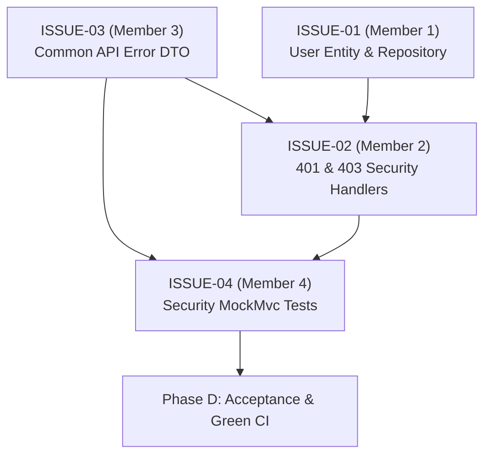

# CampusHub Foundation Phase — Team Issues Directory

This directory contains the formal, dedicated issue specifications for each of the 4 team members on the CampusHub Foundation Phase. Each issue is designed to be directly copied into GitHub Issues, GitLab Issues, or Jira.

---

## 📌 Issue Index

| Issue Code | Member / Owner | Domain & Focus | Target Feature Branch | Specification Document |
| :---: | :--- | :--- | :--- | :---: |
| **ISSUE-01** | **Member 1** | MySQL Persistence, JPA & User Entity | `feature/DB-001-database-persistence-foundation` | [ISSUE-01 Document](ISSUE-01-member-1-database-persistence.md) |
| **ISSUE-02** | **Member 2 (You)** | Spring Security, Stateless Filter & JWT | `feature/SEC-001-security-jwt-foundation` | [ISSUE-02 Document](ISSUE-02-member-2-security-authentication.md) |
| **ISSUE-03** | **Member 3** | Centralized API Errors & Conventions | `feature/SE-001-backend-api-foundation` | [ISSUE-03 Document](ISSUE-03-member-3-common-api-error-foundation.md) |
| **ISSUE-04** | **Member 4** | Test Reconciliation, Security Tests & CI | `feature/TEST-001-testing-integration-ci-foundation` | [ISSUE-04 Document](ISSUE-04-member-4-testing-integration-ci.md) |

---

## 🔄 Dependency & Coordination Flow

---

## 🛠️ Team Guidelines
- All branches branch from `developV2` and open PRs targeting `developV2`.
- Keep commits focused and prefixed according to the suggested commit conventions.
- Refer to [`../../plan.md`](../../plan.md) for overall milestone timelines and [`../../status.md`](../../status.md) for live progress.

