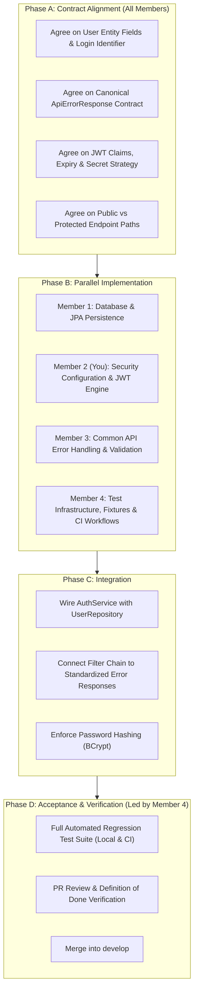

# CampusHub — Foundation Phase Team Plan

> **Objective:** Establish the core backend infrastructure (MySQL Persistence, Spring Data JPA, Spring Security stateless JWT authentication, Unified API Error Handling, and Automated Testing/CI) to provide a solid, reusable baseline before implementing business feature modules (**Profile**, **Community**, **Marketplace**, **Lost & Found**).

---

## 1. Architectural Strategy & Execution Phases

---

## 2. Member Context & Task Breakdown

### 👤 Member 1 — Database & Persistence
> 📄 **Dedicated Issue Specification:** [`docs/issues/ISSUE-01-member-1-database-persistence.md`](docs/issues/ISSUE-01-member-1-database-persistence.md)

#### Context & Responsibilities
Member 1 owns the persistence layer, data source configuration, and database entity lifecycle. All future feature modules will depend on the conventions and audit base classes established here.

#### Prerequisites & Decisions
- **Database Engine:** MySQL 8.4 (using `mysql-connector-j`).
- **Connection Configuration:** Externalized via environment variables (`${DB_USERNAME}`, `${DB_PASSWORD}`) to ensure zero credentials are committed to Git.
- **Audit Foundation:** Inherit [`BaseEntity`](backend/src/main/java/com/campushub/common/entity/BaseEntity.java) for `@CreatedDate` and `@LastModifiedDate`.
- **User Contract (Agreed with Member 2):**
  - Table name: `users`
  - Primary Key: `id` (`Long`, Auto-increment / Identity)
  - Login Identifier: `email` (`String`, Unique, Non-null, Indexed)
  - Credentials: `password` (`String`, BCrypt hashed, Non-null)
  - Authorization: `role` (`String` / `Enum`: `ROLE_USER`, `ROLE_ADMIN`)
  - Status: `enabled` (`boolean`, default `true`)
  - Timestamps: `created_at`, `updated_at` (via `BaseEntity`)

#### Concrete Tasks
1. **Task DB-01: Configure MySQL Connection & DataSource**
   - Configure development connection in [`application.properties`](backend/src/main/resources/application.properties) via environment variables.
   - Verify connection startup without errors.
2. **Task DB-02: Audit Timestamp Configuration**
   - Verify JPA Auditing via [`JpaConfig`](backend/src/main/java/com/campushub/config/JpaConfig.java) with `@EnableJpaAuditing`.
   - Ensure [`BaseEntity`](backend/src/main/java/com/campushub/common/entity/BaseEntity.java) is available as the `@MappedSuperclass`.
3. **Task DB-03: Implement User Persistence**
   - Create `com.campushub.user.entity.User` extending `BaseEntity`.
   - Create `com.campushub.user.repository.UserRepository` extending `JpaRepository<User, Long>` with `Optional<User> findByEmail(String email)` and `boolean existsByEmail(String email)`.
4. **Task DB-04: Persistence Unit Testing**
   - Write `@DataJpaTest` asserting user insertion, duplicate email constraints, and timestamp population.

#### Deliverables & Acceptance Criteria
- [ ] MySQL connection initializes properly via environment variables.
- [ ] `User` entity and `UserRepository` are implemented and tested.
- [ ] Unique constraints on `email` are enforced at database level.
- [ ] Hand-off `UserRepository` to Member 2 for authentication.

---

### 👤 Member 2 — Security & Authentication (You)
> 📄 **Dedicated Issue Specification:** [`docs/issues/ISSUE-02-member-2-security-authentication.md`](docs/issues/ISSUE-02-member-2-security-authentication.md)

#### Context & Responsibilities
Member 2 owns Spring Security integration, the HTTP filter chain, stateless JWT generation and validation, password encoding, and authentication endpoints.

#### Prerequisites & Decisions
- **Session Policy:** Fully stateless (`SessionCreationPolicy.STATELESS`), CSRF disabled for bearer-token REST API.
- **Filter Precedence:** Custom `JwtAuthenticationFilter` executes before `UsernamePasswordAuthenticationFilter`.
- **Security Exceptions:** Custom security handlers serialize into the canonical [`ApiErrorResponse`](backend/src/main/java/com/campushub/common/dto/ApiErrorResponse.java) schema directly to `HttpServletResponse`:
  - Missing / Invalid Authentication $\rightarrow$ [`RestAuthenticationEntryPoint`](backend/src/main/java/com/campushub/common/security/RestAuthenticationEntryPoint.java) (HTTP `401 UNAUTHORIZED`).
  - Insufficient Role / Forbidden $\rightarrow$ [`RestAccessDeniedHandler`](backend/src/main/java/com/campushub/common/security/RestAccessDeniedHandler.java) (HTTP `403 FORBIDDEN` / `ACCESS_DENIED`).
- **Jackson Version:** Jackson 3 (`tools.jackson.databind.ObjectMapper`) as required by Spring Boot 4.

#### Concrete Tasks
1. **Task SEC-01: Refactor & Polish SecurityConfig**
   - Rename `securityConfig.java` to standard PascalCase `SecurityConfig.java`.
   - Ensure clean route rules:
     - Public: `/api/auth/**`, `/api/health`
     - Admin-only: `/api/admin/**`
     - Authenticated: `anyRequest().authenticated()`
2. **Task SEC-02: Clean Up Custom Security Handlers**
   - Remove unused imports in [`RestAuthenticationEntryPoint.java`](backend/src/main/java/com/campushub/common/security/RestAuthenticationEntryPoint.java).
   - Align error code in [`RestAccessDeniedHandler.java`](backend/src/main/java/com/campushub/common/security/RestAccessDeniedHandler.java) (`"FORBIDDEN"` or `"ACCESS_DENIED"`).
3. **Task SEC-03: Add Dependencies & PasswordEncoder Bean**
   - Add JWT library (`jjwt-api`, `jjwt-impl`, `jjwt-jackson` or Spring Security OAuth2 Resource Server) to `pom.xml`.
   - Declare `@Bean public PasswordEncoder passwordEncoder() { return new BCryptPasswordEncoder(); }` in `SecurityConfig`.
4. **Task SEC-04: Implement JwtService**
   - Create `com.campushub.security.jwt.JwtService` to handle:
     - Token generation (claims: subject=email, roles, issuedAt, expiration).
     - Token validation (signature verification, expiration check).
     - Extract username/email from token.
5. **Task SEC-05: Implement JwtAuthenticationFilter**
   - Extract `Authorization: Bearer <token>` header.
   - Validate token via `JwtService`.
   - Load user principal and populate `SecurityContextHolder.getContext().setAuthentication(...)`.
   - Register filter in `SecurityConfig`.
6. **Task SEC-06: Implement Auth Endpoints (Integration with Member 1)**
   - Create `RegisterRequest`, `LoginRequest`, `AuthResponse` DTOs.
   - Implement `AuthService` (hash password on registration, verify on login).
   - Expose `POST /api/auth/register` and `POST /api/auth/login` in `AuthController`.

#### Deliverables & Acceptance Criteria
- [ ] `SecurityConfig` cleanly compiles with stateless filter chain and custom 401/403 handlers.
- [ ] Unauthenticated requests receive HTTP 401 with `ApiErrorResponse`.
- [ ] Unauthorized requests receive HTTP 403 with `ApiErrorResponse`.
- [ ] Valid JWT permits access to protected endpoints; expired/tampered JWT is rejected.
- [ ] Passwords stored using BCrypt hash.

---

### 👤 Member 3 — Common API Error Foundation
> 📄 **Dedicated Issue Specification:** [`docs/issues/ISSUE-03-member-3-common-api-error-foundation.md`](docs/issues/ISSUE-03-member-3-common-api-error-foundation.md)

#### Context & Responsibilities
Member 3 is responsible for establishing the canonical API error schema and global exception handling, ensuring consistent error responses across all present and future modules without information leakage.

#### Prerequisites & Decisions
- **Single Canonical DTO:** [`ApiErrorResponse`](backend/src/main/java/com/campushub/common/dto/ApiErrorResponse.java) is the **only** error format permitted.
- **Information Hiding:** On 500 errors, never leak stack traces, SQL syntax, or internal class names to clients. Log original exceptions server-side via SLF4J.
- **Clean Boundary:** Service and Controller layers throw semantic exceptions; `@RestControllerAdvice` formats them. Security filter-level errors are handled by Member 2's security handlers.

#### Concrete Tasks
1. **Task ERR-01: Canonical Error DTO Contract**
   - Verify [`ApiErrorResponse.java`](backend/src/main/java/com/campushub/common/dto/ApiErrorResponse.java) schema: `status`, `error`, `message`, `fields` (optional map), `timestamp`.
2. **Task ERR-02: Semantic Exception Hierarchy**
   - Maintain semantic application exceptions:
     - [`BadRequestException`](backend/src/main/java/com/campushub/common/exception/BadRequestException.java) $\rightarrow$ 400
     - [`ConflictException`](backend/src/main/java/com/campushub/common/exception/ConflictException.java) $\rightarrow$ 409
     - [`ResourceNotFoundException`](backend/src/main/java/com/campushub/common/exception/ResourceNotFoundException.java) $\rightarrow$ 404
   - Delete duplicate/untracked `com.campushub.common.exception.AccessDeniedException` to avoid conflicting with Spring Security's native class.
3. **Task ERR-03: Global Exception Handler (`@RestControllerAdvice`)**
   - Ensure [`GlobalExceptionHandler.java`](backend/src/main/java/com/campushub/common/exception/GlobalExceptionHandler.java) handles:
     - 400 `BadRequestException`
     - 400 `MethodArgumentNotValidException` (maps field errors to dictionary)
     - 404 `ResourceNotFoundException`
     - 409 `ConflictException`
     - 500 `Exception` fallback (generic safe message)
4. **Task ERR-04: Conventions Documentation**
   - Maintain [`docs/backend-conventions.md`](docs/backend-conventions.md) as the single source of truth for architectural layering and error conventions.

#### Deliverables & Acceptance Criteria
- [ ] Standardized `ApiErrorResponse` returned across all exception types.
- [ ] Validation errors include detailed field-level error mappings.
- [ ] Zero stack traces or database schema internals exposed on 500 errors.
- [ ] Conflicting duplicate exception classes removed.

---

### 👤 Member 4 — Testing, Integration & CI
> 📄 **Dedicated Issue Specification:** [`docs/issues/ISSUE-04-member-4-testing-integration-ci.md`](docs/issues/ISSUE-04-member-4-testing-integration-ci.md)

#### Context & Responsibilities
Member 4 acts as the quality and integration lead. Member 4 creates integration test fixtures, manages CI workflows, reconciles test assertions, and coordinates Phase D Acceptance Testing to enforce the Definition of Done.

#### Prerequisites & Decisions
- **Testing Pyramid:**
  - Unit tests: Assert DTOs, factories, and exception mapping.
  - WebMvc tests: Use `MockMvc` to verify HTTP status codes, headers, and response payloads.
  - Security tests: Use `@SpringBootTest` + `@AutoConfigureMockMvc` to verify the filter chain.
- **CI Enforcement:** GitHub Actions must pass on every PR to `develop`.

#### Concrete Tasks
1. **Task TEST-01: GitHub Actions CI Maintenance**
   - Verify [`.github/workflows/ci.yml`](.github/workflows/ci.yml) builds frontend and backend with MySQL 8.4 service container.
2. **Task TEST-02: Reconcile Unit Test Failures (Immediate Blocker)**
   - Update [`GlobalExceptionHandlerTest.java`](backend/src/test/java/com/campushub/common/exception/GlobalExceptionHandlerTest.java):
     - Remove tests asserting controller-level throwing of deleted `UnauthorizedException` and `ForbiddenException`.
     - Ensure all remaining `@RestControllerAdvice` tests pass (400, 404, 409, 500, Validation).
3. **Task TEST-03: Implement Security Filter Chain Tests**
   - Create `com.campushub.security.SecurityErrorHandlingTest`:
     - Test unauthenticated request to protected endpoint $\rightarrow$ `401 UNAUTHORIZED`.
     - Test authenticated user without admin role to `/api/admin/**` $\rightarrow$ `403 FORBIDDEN`.
     - Test public endpoint `/api/health` $\rightarrow$ `200 OK`.
     - Verify both 401 and 403 responses match `ApiErrorResponse` JSON structure.
4. **Task TEST-04: User Persistence & Integration Tests**
   - Assist Member 1 with `UserRepositoryTest`.
   - Prepare test cases for duplicate registration (409) and invalid registration bodies (400).
5. **Task TEST-05: Phase D Acceptance Testing & Verification**
   - Run full `./mvnw clean test` locally and verify zero failures.
   - Validate PRs against the Definition of Done checklist.

#### Deliverables & Acceptance Criteria
- [ ] Full backend test suite (`./mvnw test`) executes with 100% green pass.
- [ ] Security filter chain tests verify 401 and 403 error formats.
- [ ] CI pipeline runs and passes on pull requests.

---

## 3. Team Coordination & Integration Rules

1. **Branching Strategy:** Work on feature branches branched from `developV2`. Submit small, focused pull requests targeting `developV2`.
2. **Zero Secret Leaks:** Never commit database credentials or JWT secret keys. Use environment variable substitution (`${DB_USERNAME}`, `${JWT_SECRET}`).
3. **Contract First:** Agree on DTOs and signatures before writing dependent service/controller code.
4. **File Ownership:** Avoid simultaneous edits to [`GlobalExceptionHandler.java`](backend/src/main/java/com/campushub/common/exception/GlobalExceptionHandler.java) and security classes between Members 2 and 3.
5. **Clear Defect Reporting:** Member 4 must report failing tests with reproducible steps, payloads, and expected vs. actual status codes.

---

## 4. Definition of Done (DoD) Checklist

- [ ] Application connects to MySQL via environment variables.
- [ ] JPA Auditing populates `createdAt` and `updatedAt` automatically.
- [ ] `User` entity and repository implemented with unique email constraint.
- [ ] Passwords stored using BCrypt encryption.
- [ ] Stateless JWT authentication filter operational.
- [ ] Protected endpoints reject missing, invalid, or expired tokens (HTTP 401).
- [ ] Role-based access control rejects unauthorized users (HTTP 403).
- [ ] All error responses strictly use `ApiErrorResponse` DTO.
- [ ] Bean Validation returns field-level error dictionary on HTTP 400.
- [ ] 500 Internal Server Error hides database and stack trace details.
- [ ] All automated tests pass locally (`./mvnw test` = 0 failures).
- [ ] GitHub Actions CI pipeline passes cleanly on PR.

